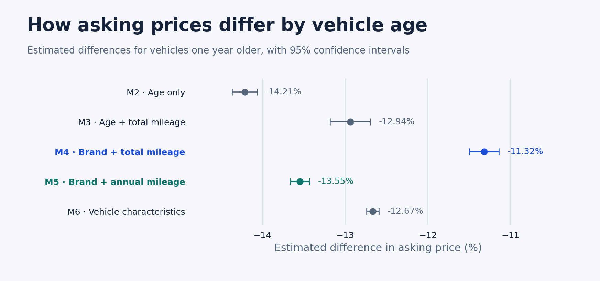

# Vehicle Age, Mileage, and UK Used-Car Asking Prices

A regression analysis of **96,255 UK used-car listings across nine brands**. It asks how the estimated relationship between vehicle age and asking price changes when we compare cars at the same total mileage or at the same estimated annual mileage.

[Regression notebook](notebooks/03_regression.ipynb) · [Results CSV](figures/regression_summary.csv) · [Data dictionary](data/README.md) · [Reproduce the results](#reproduce-the-results)

## Main findings

Within the same brand, vehicles one year older had estimated asking prices **11.32% lower at the same total mileage** and **13.55% lower at the same estimated annual mileage**.

| Model | Mileage held constant | Estimated asking-price difference for one additional year of age | 95% CI |
| --- | --- | ---: | ---: |
| M4 | Total mileage | −11.32% | −11.50% to −11.14% |
| M5 | Estimated annual mileage | −13.55% | −13.66% to −13.43% |



The two mileage measures describe different comparisons. A three-year-old car and a five-year-old car at 8,000 miles per year have 24,000 and 40,000 total miles, respectively. Holding annual mileage constant compares usage intensity, while holding total mileage constant compares cars with the same accumulated mileage.

### Multicollinearity

Vehicle age and total mileage tend to move together. This overlap between predictors, called **multicollinearity**, can make their individual regression coefficients less precise. The correlation with age was **0.75** for total mileage and **0.14** for estimated annual mileage. In a diagnostic using each age–mileage pair alone, the variance inflation factor (VIF) was **2.305** with total mileage and **1.020** with estimated annual mileage. The lower VIF reflects less overlap between age and the annual mileage measure. [Mileage comparison](figures/03_age_vs_mileage.png) · [VIF calculations](notebooks/03_regression.ipynb)

## Data and methods

- **Sample.** The analysis combines nine brand files from Aditya Desai’s [100,000 UK Used Car Data Set](https://www.kaggle.com/adityadesai13/used-car-dataset-ford-and-mercedes), listed on Kaggle as **CC0: Public Domain**. Cleaning reduced 99,187 rows to 96,255. The [data dictionary](data/README.md) records the fields, units, and sample counts.
- **Measures.** Vehicle age is calculated as `2020 − year`. Estimated annual mileage is total mileage divided by `max(age, 1)`. Asking price is recorded in GBP and modeled on the natural-log scale.
- **Estimation.** Six OLS models compare mileage, age, and vehicle characteristics. Coefficients are converted to percentage differences using `100 × (exp(β) − 1)`. The confidence intervals use HC3 heteroskedasticity-robust standard errors. The [regression notebook](notebooks/03_regression.ipynb) contains the formulas and diagnostics.

## Sensitivity and scope

| Specification or sample | Estimated asking-price difference for one additional year of age |
| --- | ---: |
| M5, all 96,255 listings | −13.55% |
| M5, age at least one year (92,343 listings) | −13.58% |
| M5, age at least two years (66,570 listings) | −12.25% |
| M6, controls for vehicle model, transmission, fuel type, and engine size | −12.67% |

The first restricted sample checks the treatment of vehicles assigned age zero. The second checks how the estimate changes when the sample excludes the two youngest age groups. M6 has an in-sample `R²` of 0.938. [See the brand-by-brand estimates](figures/05_age_effect_by_brand.png).

The estimates compare different vehicles in a cross-section of listings and describe conditional associations. The data record asking prices and do not track individual vehicles over time. Vehicle condition, accident history, options, and sale region are unavailable. About 98% of the sample is zero to seven years old.

## Reproduce the results

Use Python 3.12 in a virtual environment and run the commands from the repository root.

```bash
python -m pip install -r requirements.txt
```

**Using the included analysis data**

```bash
jupyter nbconvert --to notebook --execute --inplace --ExecutePreprocessor.timeout=600 notebooks/02_eda.ipynb notebooks/03_regression.ipynb
```

**Starting with the Kaggle data**

```bash
python src/download_data.py
jupyter nbconvert --to notebook --execute --inplace --ExecutePreprocessor.timeout=600 notebooks/01_cleaning.ipynb notebooks/02_eda.ipynb notebooks/03_regression.ipynb
```

The commands update the executed notebooks and regenerate the corresponding figures and tables. The full workflow also rebuilds `data/processed/cars_clean.csv`.

## Repository guide

| Location | What it contains |
| --- | --- |
| [`notebooks/01_cleaning.ipynb`](notebooks/01_cleaning.ipynb) | Source files, cleaning decisions, and row counts |
| [`notebooks/02_eda.ipynb`](notebooks/02_eda.ipynb) | Distributions, scatterplots, and correlations |
| [`notebooks/03_regression.ipynb`](notebooks/03_regression.ipynb) | Models, confidence intervals, and sensitivity checks |
| [`data/`](data/README.md) | Data provenance, dictionary, and analysis-ready CSV |
| [`figures/`](figures/) | Figures and the regression summary CSV |
| [`src/`](src/) | Data retrieval, cleaning, and variable definitions |
