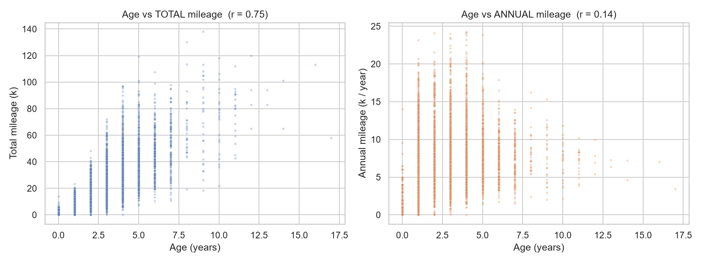

# Used Car Prices: Separating the Effects of Age and Mileage

A regression analysis of about 96,000 UK used car listings, asking **how a car's age and mileage affect its price**.
Age and total mileage move together (correlation 0.75), which makes their effects hard to separate (multicollinearity).
Using **annual mileage instead of total mileage** makes the two variables nearly independent (correlation 0.14, VIF 2.3 → 1.0), so the effect of age can be estimated cleanly.

## Key result

> Holding annual mileage and brand constant, **each additional year of age lowers a car's price by about 13.5%** (95% CI: −13.7% to −13.4%).

| Model | Explanatory variables | Per year of age | Per 1,000 miles | R² |
|---|---|---|---|---|
| M1 | Total mileage | – | −1.23% | 0.24 |
| M2 | Age | −14.2% | – | 0.36 |
| M3 | Total mileage + age | −12.9% | −0.20% | 0.36 |
| M4 | Total mileage + age + brand | −11.3% | −0.38% | 0.68 |
| **M5** | **Annual mileage + age + brand** | **−13.5%** | **−1.06% (annual)** | **0.67** |
| M6 | M5 + car model, transmission, fuel, engine size | −12.7% | −1.53% (annual) | 0.94 |

The dependent variable is `log(price)`; each coefficient β is converted to a `(e^β − 1) × 100` percent change. Standard errors are heteroskedasticity-robust (HC3).




## Steps

1. **[01_cleaning](notebooks/01_cleaning.ipynb)**: combine the 9 brand files; remove duplicates, typos (such as a model year of 2060) and extreme values (99,187 → 96,255 rows); create derived variables
   - `age = 2020 − year`, `annual_mileage = mileage / max(age, 1)`, `log_price = ln(price)`
2. **[02_eda](notebooks/02_eda.ipynb)**: distributions, price against age and mileage, and the correlation of age with total vs. annual mileage
3. **[03_regression](notebooks/03_regression.ipynb)**: compare models M1–M6, VIF diagnostics, robustness checks by brand

## What I learned

- **Multicollinearity:** When age and total mileage are both in the model, they split the information they share. The mileage coefficient shrinks from −1.2% to −0.2% per 1,000 miles: on its own, mileage was also picking up part of the effect of age. The VIF here is about 2.3, which is not severe, but it makes the coefficients hard to read as "the effect with everything else held constant".
- **Redefining a variable:** Replacing total mileage with annual mileage (how intensively the car was used) splits the question into two distinct ones: how old is the car, and how heavily was it driven.
- **Log transformation:** Using `log(price)` lets coefficients be read as percent changes and reduces the right skew of the price distribution.
- **Robustness:** Adding controls such as car model, or estimating each brand separately, keeps the age effect within 10–16% per year.

## Limitations

- This is observational data, so the estimates are conditional associations, not causal effects.
- There is no information on accident history, condition, options or region of sale.
- The data covers the 2020 UK market and mostly cars aged 0–7 years, so the results may not generalize to older cars or other markets.

## Data

Kaggle: [100,000 UK Used Car Data set](https://www.kaggle.com/datasets/adityadesai13/used-car-dataset-ford-and-mercedes) (Aditya Desai).

- **Cleaned data** (96,255 rows, with derived variables) is included at [`data/processed/cars_clean.csv`](data/processed/cars_clean.csv), so the EDA and regression notebooks can be run directly.
- The raw data is not included; `src/download_data.py` downloads it, and `notebooks/01_cleaning.ipynb` rebuilds the cleaned file from it.

## How to run

```bash
pip install -r requirements.txt
python src/download_data.py        # saves the raw CSV files to data/raw (no login needed)
jupyter nbconvert --to notebook --execute --inplace notebooks/*.ipynb
```

## Structure

```
├── data/processed/        # cleaned data (cars_clean.csv)
├── src/
│   ├── features.py        # loading, cleaning, derived variables
│   └── download_data.py   # downloads the Kaggle dataset
├── notebooks/             # 01 cleaning → 02 EDA → 03 regression
├── figures/               # charts and regression summary table
└── requirements.txt
```
